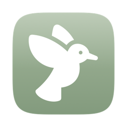
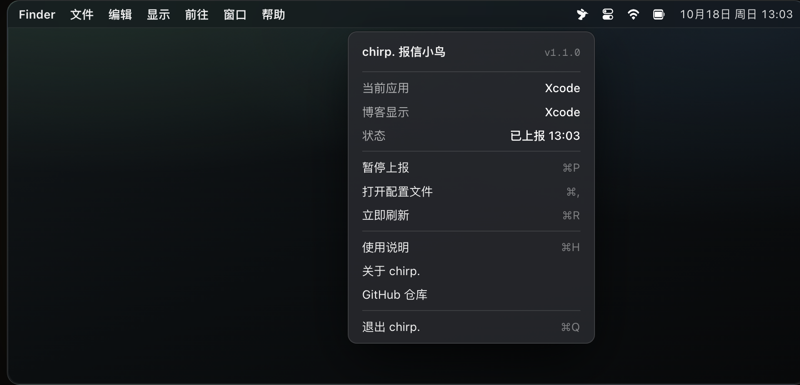

<div align="center">


# chirp.

**报信小鸟，把正在使用的软件带到博客。**

[](https://github.com/poboll/chirp/releases)
[](LICENSE)
[](Package.swift)

[官网](https://chirp.caiths.com/) · [下载](https://github.com/poboll/chirp/releases/latest) · [问题反馈](https://github.com/poboll/chirp/issues)



</div>

纯 Swift / AppKit，无第三方运行依赖。监听前台应用切换，经过 3 秒防抖后上报；不采集窗口标题、输入内容或屏幕截图。菜单里的“服务端应用”来自接口读回，网页是否显示仍取决于主题配置。

## 先选对接口

| 博客使用的方案 | chirp 配置 | 心跳 / 有效期 |
| --- | --- | --- |
| 新版 mx-core + Yohaku / Live Desk | `/api/v3/companion/presence` + `deviceId` + `deviceToken` | 30 秒 / 90 秒租约 |
| Shiro / 自建旧活动组件 | `/api/v3/fn/ps/update` + `key` | 默认 240 秒 / 函数缓存 300 秒 |

**v1.2.0 新增 Companion v2 支持。v1.1.0 及以前只支持旧云函数。**

后端升级后会提供内置 Companion 路由，不会替旧客户端创建配对或转换密钥。仅修改 endpoint 无法迁移，旧 `key` 不能作为设备令牌使用。主题需要启用 Live Desk（`module.liveDesk.enable`）。仍使用旧主题时继续选云函数方案。

```text
应用切换 → chirp → Companion PUT /presence → 90 秒租约 + 实时广播 → Live Desk
                   或旧云函数 POST ps/update → 缓存 + 广播 → 旧活动组件
```

可公开检查后端能力：

```bash
curl -fsS https://your-api.example.com/api/v3/companion/capabilities
curl -fsS https://your-api.example.com/api/v3/companion/presence/public
```

`presenceSchemaVersions` 包含 `2` 表示后端支持本实现。`projection: null` 表示当前没有有效在线状态，不代表接口缺失。

## 安装

macOS 13+。Release 提供 Apple Silicon 版本；Intel 可自行编译。

```bash
curl -fsSL https://raw.githubusercontent.com/poboll/chirp/main/scripts/install.sh | bash
```

脚本安装到 `/Applications/chirp.app` 并配置 LaunchAgent。已有配置会保留；首次安装请先按下文准备配置。Release 为 ad-hoc 签名，未做 Apple 公证。

## 新版博客：Companion 配对

1. 在博客管理后台的 Companion 设备管理中创建配对码，仅勾选 `companion:presence:write`。接口对应 `POST /api/v3/companion/pairings`，需要站长身份。
2. 在本仓库运行配对助手，交互输入短期配对码；设备令牌不会输出到终端：

```bash
git clone https://github.com/poboll/chirp.git
cd chirp
python3 scripts/pair-companion.py --api-base https://your-api.example.com/api/v3
```

助手需要 Python 3；会备份原配置，再以 `0600` 权限写入新配置。也可使用官方配对接口 `POST /companion/pairings/claim`，手动填写结果：

```json
{
  "endpoint": "https://your-api.example.com/api/v3/companion/presence",
  "deviceId": "配对返回的 UUID",
  "deviceToken": "配对返回的设备令牌"
}
```

3. 点小鸟 → **立即刷新（⌘R）**，重读配置并上报。菜单显示已上报、服务端应用与当前应用一致后，再打开博客确认 Live Desk。需要时在主题配置开启 `module.liveDesk.enable`。

Companion 使用 schema `yohaku.companion.presence` v2，发送协议兼容头 `x-yohaku-companion-version: 1.7.3`。这是上游协议兼容级别，与 chirp 版本号分别管理。设备令牌仅授权前台应用状态；无需把站长 API key 放入 chirp。

## 旧博客：云函数

在 mx-space 后台创建 POST 函数 `ps/update`。读分支接收空对象，写分支验证 `key`，写缓存并广播 `ps-update`。完整示例见[旧版接入文档](https://chirp.caiths.com/#legacy)。升级后若函数返回 500，应检查云函数运行环境，或随新主题迁移至 Companion。

`~/.config/chirp/config.json`：

```json
{
  "endpoint": "https://your-api.example.com/api/v3/fn/ps/update",
  "key": "与服务端函数一致的密钥"
}
```

```bash
chmod 600 ~/.config/chirp/config.json
curl -fsS -X POST -H 'Content-Type: application/json' \
  -d '{}' https://your-api.example.com/api/v3/fn/ps/update
```

旧模式写入格式：`{key, timestamp, process:{name, iconUrl?, iconBase64?}}`；`timestamp` 为毫秒。读取兼容原始对象及 `{data:…}` 包裹。只有收到成功确认才显示“已上报”。

## 菜单与配置

| 外观 / 操作 | 含义 |
| --- | --- |
| 系统单色小鸟 | 最近一次上报得到服务端确认 |
| 橙色小鸟 | 等待首次上报或已暂停 |
| 红色小鸟 | 上报、配置或清除状态失败；展开菜单查看原因 |
| ⌘P | 暂停 / 继续；Companion 暂停会立即清除在线状态 |
| ⌘R | 重读配置并刷新 |
| ⌘, | 在 Finder 定位配置文件 |
| ⌘H | 打开官网 |
| ⌘Q | 正常退出；不会被 LaunchAgent 立即拉起 |


| 可选字段 | 默认 / 约束 |
| --- | --- |
| `debounceSeconds` | `3`；须 ≥ 0 |
| `heartbeatSeconds` | 旧模式 `240`，须 < 300；Companion 默认 `30`，较大值自动压至 30 |
| `iconManifestUrl` | `https://fastly.jsdelivr.net/gh/poboll/app-icons@main/manifest.json` |
| `iconBase` | `https://fastly.jsdelivr.net/gh/poboll/app-icons@main/icons` |

所有可选字段可以省略。配置格式错误时保留原文件；刷新发现无效配置会暂停上报。修复后刷新，再选择继续上报。

应用图标优先从 [app-icons](https://github.com/poboll/app-icons) CDN 清单匹配；旧模式未命中时使用本机图标的 data URI。Companion 只接受 HTTPS 图标，未命中时仅上报应用名，主题也可使用自己的映射。**菜单栏的小鸟**与**博客中的应用图标**是两类图标。

Companion 在暂停、睡眠与正常退出时发送清除请求；断网或强制退出时最迟等 90 秒租约失效。旧云函数模式停止上报后等待函数缓存到期，不发送清除。

失败后自动按 5、10、20、40、60 秒退避重试，成功后重置；暂停会取消待执行重试。正常心跳独立运行，每次也会尝试续期。


## 排查

- **401 / DEVICE_REVOKED**：检查使用的是新设备令牌还是旧 key；被撤销的设备需重新配对。
- **404**：核对域名与 `/api/v3` 前缀。旧函数常只注册 POST，直接 GET 并非有效读法。
- **426**：协议版本不兼容，先检查 capabilities 与客户端版本。
- **500**：服务端执行失败，检查服务端日志；不要反复更换本机图标或密钥。
- **菜单已成功、网页没变化**：先确认服务端读回；新主题须启用 Live Desk，旧活动组件只读旧函数。
- **Companion 有名称、没有图标**：图标必须是 HTTPS URL，内嵌 Base64 不在新版协议范围内。

## 开发

```bash
swift test
CHIRP_VERSION=1.2.0 bash scripts/build-app.sh --dist  # 仅打包
CHIRP_VERSION=1.2.0 bash scripts/build-app.sh         # 本机安装
bash scripts/install-launch-agent.sh
```

`build/`、`.build/`、`dist/` 为本地构建产物。签名、配对及应用切换验收见 [2026-11-12 记录](docs/verification-2026-11-12.md)。

## 致谢与许可

灵感和旧协议来自 [Innei/ProcessReporter](https://github.com/Innei/ProcessReporter) 与 [mx-space/ProcessReporterMac](https://github.com/mx-space/ProcessReporterMac)。新版协议遵循 [mx-space/core Companion](https://github.com/mx-space/core/tree/master/apps/core/src/modules/companion)，前端见 [Yohaku](https://github.com/Innei/Yohaku)。

chirp 为独立项目，采用 [MIT](LICENSE) 许可。
