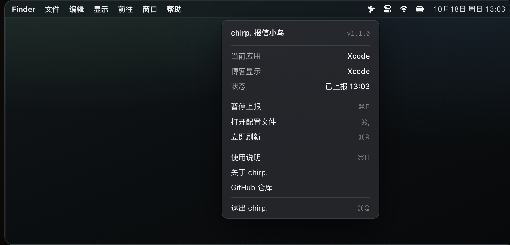

<div align="center">


# chirp.

**报信小鸟** —— 把「正在使用的软件」实时汇报给你的博客。

[](https://github.com/poboll/chirp/releases)
[](LICENSE)
[](Package.swift)
[](https://poboll.github.io/chirp/)

[官网](https://poboll.github.io/chirp/) · [下载 Release](https://github.com/poboll/chirp/releases/latest)

</div>

<div align="center">



<sub>装上之后，菜单栏右侧就是这只小鸟 —— 下拉菜单展示「当前应用 / 博客显示 / 上报状态」。</sub>

</div>

---

`chirp.` 是一个 macOS 菜单栏应用：监听前台应用切换，实时上报到博客。访客打开你的站点，导航栏就能看到「正在使用 Xcode」。

脱胎于 [Innei](https://github.com/Innei) 的 [ProcessReporter](https://github.com/Innei/ProcessReporter) 与 [mx-space/ProcessReporterMac](https://github.com/mx-space/ProcessReporterMac)，砍到只剩一件事：**报信**。没有 Slack、没有 Discord、没有 S3，一只小鸟就够。

## 特性

- **轻**：纯 AppKit + Swift Package，零第三方依赖，release 二进制约 **250KB**
- **省**：只在应用切换时上报（3 秒防抖），每 4 分钟心跳续期一次（服务端缓存 5 分钟）
- **稳**：睡眠唤醒自动补报、失败菜单栏图标变红、`KeepAlive` 常驻
- **静**：`LSUIElement` 无 Dock 图标，只住菜单栏
- **带图标**：上报携带应用图标，三层自动回落（见下），新装软件零操作

## 工作方式

```text
切换应用 ──防抖 3s──▶ POST /api/v3/fn/ps/update
                        {key, timestamp, process: {name, iconUrl?, iconBase64?}}
                              │
                              ▼
           mx-space 函数（fn snippet）写入缓存 + WebSocket 广播
                              │
                              ▼
               博客导航栏「正在使用 XX」
```

上报内容只有三样：**应用名、图标、时间戳**。没有窗口标题、没有输入内容、没有截屏。

---

## 生态与兼容性

chirp 是 [Innei](https://github.com/Innei) 的 **mx-space 生态**中的一块拼图。

### 后端

| 项目 | 说明 | 状态 |
|---|---|---|
| [mx-space/core](https://github.com/mx-space/core) | 无头 CMS，NestJS + Fastify + PostgreSQL + Redis，v12 起用 PostgreSQL | 活跃 · AGPLv3 + MIT |
| [mx-space/api-client](https://github.com/mx-space/api-client) | mx-space RESTful API 的 TypeScript 客户端，Yohaku 的 Companion 调用即出自此 | **已归档** · ★5 |

### 前端 / 主题

| 项目 | 说明 | 状态 |
|---|---|---|
| [Innei/Yohaku](https://github.com/Innei/Yohaku) | 余白 —— 排版设计系统 + iOS 客户端，线上实例 [innei.in](https://innei.in) | 活跃 · 设计系统 MIT |
| [Innei/Shiro](https://github.com/Innei/Shiro) | 极简个人站，纸雪质感，★4k+ | 活跃 · AGPLv3 |
| **Shiroi**（`innei-dev/Shiroi`） | Yohaku 的上一代付费前端，与 Yohaku 分离、赞助关系独立 | 赞助获取 · 仓库非公开 |
| [mx-space/kami](https://github.com/mx-space/kami) | 动漫风经典前端 | 维护中（legacy） |
| [mx-space/mx-admin](https://github.com/mx-space/mx-admin) | 上一代 Vue 3 管理后台 | **已归档**（功能已并入 core） |

Yohaku 由两部分构成：[Innei/Yohaku](https://github.com/Innei/Yohaku) 公开 iOS 客户端（MIT）+ 设计系统（MIT）+ 跨端渲染包；完整 Web 实现在赞助后可访问的仓库中持续维护，需 mx-core v12+。获取方式：通过 [GitHub Sponsors](https://github.com/sponsors/Innei) 赞助后在 [Yohaku Issues](https://github.com/Innei/Yohaku/issues) 提交用户名开通。Shiro、Shiroi、Yohaku 的访问权限与赞助关系相互独立。

### 上报端（chirp 的前辈）

| 项目 | 说明 | 状态 |
|---|---|---|
| [Innei/ProcessReporter](https://github.com/Innei/ProcessReporter) | 最初的 macOS 上报器（Swift/AppKit） | **已归档** |
| [mx-space/ProcessReporterMac](https://github.com/mx-space/ProcessReporterMac) | 为 Shiro 而生的上报器，经服务端 WebSocket 实时推给访客 | 活跃 · MIT |
| [Innei/reporter-assets](https://github.com/Innei/reporter-assets) | 应用名 → 图标/描述的资源库（约 80 个常用应用，含中文名映射） | 活跃 |
| [poboll/app-icons](https://github.com/poboll/app-icons) | chirp 自用的图标库（**239 个应用**，jsdelivr CDN，每日刷新） | 活跃 · chirp 维护 |

### 两套「正在使用」机制

生态中存在两代方案，接口不同：

1. **函数订阅式（chirp 采用）**：客户端 POST 到 mx-space Serverless 函数 `/api/v3/fn/ps/update`，函数写入缓存并 WebSocket 广播。只需一个 fn snippet、前端主题消费接口。适用于自建博客、Shiro 时代以及自定义实现。
2. **mx-core Companion（新一代）**：mx-core 内置 `companion` 模块，路由 `PUT /companion/presence`、`POST /companion/presence/clear`、`GET /companion/presence/public`（schema `yohaku.companion.presence` v2，建议 30 秒心跳、租约 30–120 秒）。Yohaku 的「Live Desk」即消费此接口。

chirp 对接的是方案 1。若使用 Yohaku Live Desk（方案 2），需等 chirp 适配 Companion 协议，或另配中转函数。Shiro 与自建博客用方案 1 即可。

---

## 使用

### 方式一：一键安装（推荐）

macOS 13+ · Apple Silicon（arm64）。Intel 版请按方式二自行编译。

先在 mx-space 后台准备好 `ps/update` 函数（见「服务端」或[官网](https://poboll.github.io/chirp/#integration)）：

```bash
# 交互式安装：装好后点小鸟 → 打开配置文件（⌘,）填 endpoint 和 key
curl -fsSL https://raw.githubusercontent.com/poboll/chirp/main/scripts/install.sh | bash

# 无人值守：配置以参数注入（密钥只写本机 ~/.config/chirp/config.json，权限 600）
bash install.sh --endpoint https://your-blog.example.com/api/v3/fn/ps/update --key YOUR_KEY
```

安装脚本会：下载最新 Release → 装入 `/Applications` → 写配置（若给参数）→ 配好开机自启并立即启动。

### 方式二：源码构建

1. 配置 `~/.config/chirp/config.json`（权限 600）。最小配置只需两行：

```json
{
  "endpoint": "https://your-blog.example.com/api/v3/fn/ps/update",
  "key": "与 snippet 一致的密钥"
}
```

完整模板（官网「配置」节推荐）：

```json
{
  "endpoint": "https://your-blog.example.com/api/v3/fn/ps/update",
  "key": "与 snippet 一致的密钥",
  "debounceSeconds": 3,
  "heartbeatSeconds": 240,
  "iconManifestUrl": "https://fastly.jsdelivr.net/gh/poboll/app-icons@main/manifest.json",
  "iconBase": "https://fastly.jsdelivr.net/gh/poboll/app-icons@main/icons"
}
```

一行写入：

```bash
mkdir -p ~/.config/chirp && cat > ~/.config/chirp/config.json <<'EOF'
{ "endpoint": "https://your-blog.example.com/api/v3/fn/ps/update", "key": "YOUR_KEY" }
EOF
chmod 600 ~/.config/chirp/config.json
```

| 字段 | 默认 | 说明 |
|---|---|---|
| `endpoint` | 必填 | `ps/update` 函数完整地址，含 `/api/v3/fn/` 前缀 |
| `key` | 必填 | 与 snippet 内 `AUTH_KEY` 一致；不一致一律 401 |
| `debounceSeconds` | `3` | 切换应用后延迟上报，避免快速切换刷屏 |
| `heartbeatSeconds` | `240` | 心跳续期；服务端缓存 300 秒，须小于它 |
| `iconManifestUrl` | app-icons CDN | 应用名 → 图标清单，默认指向 [poboll/app-icons](https://github.com/poboll/app-icons) |
| `iconBase` | app-icons CDN | 图标 URL 前缀；未命中回落内嵌 data URI |

配置损坏时 chirp 不会覆盖文件，仅在菜单栏提示错误。`iconManifestUrl` / `iconBase` 可替换为自定义图标库，格式见 app-icons 的 `manifest.json`。

2. 构建安装：

```bash
sh scripts/build-app.sh            # 构建 + 组装 + 安装到 /Applications
sh scripts/install-launch-agent.sh # 开机自启动 + 立即运行
```

菜单栏小鸟：单击查看「当前应用 / 博客显示 / 上次上报结果」。`⌘P` 暂停，`⌘R` 立即刷新，`⌘,` 打开配置，`⌘H` 使用说明（[官网](https://poboll.github.io/chirp/)）。

### 服务端：一个 `ps/update` 函数

在 mx-space 后台 → Serverless 函数 → 新建，路径 `ps/update`、Method **POST**。逻辑：校验 key → 写缓存 → 应用名变化时广播。完整 snippet（含读分支、缓存 TTL、WebSocket 广播）见[官网接入文档](https://poboll.github.io/chirp/#integration)，请求体 `{key, process:{name, iconUrl?, iconBase64?}}`。

## 图标从哪来

前端「正在使用」的应用图标按三层回落，无需手动配置：

1. **主题内置映射**：生态通用的 [Innei/reporter-assets](https://github.com/Innei/reporter-assets)（Xcode、VS Code 等常见开发软件，含中文应用名）；
2. **app-icons CDN**：按 [poboll/app-icons](https://github.com/poboll/app-icons) 的 `manifest.json` 将应用名映射为 jsdelivr CDN 图标（约 240 个常见 macOS 应用，manifest 每日自动刷新）；
3. **data URI 兜底**：两者都未命中时，直接抓取本机应用图标内嵌上报。新装软件立即可用，入 app-icons 仓库后自动切换为 CDN 轻量模式。

扩充 CDN 图标库：`swift scripts/ExportIcons.swift` 导出本机图标与 manifest，向 app-icons 仓库提 PR。

## 开发

```bash
swift build            # 构建
swift run              # 本地跑
swift scripts/IconGen.swift build/AppIcon.iconset  # 重新生成圆角图标
```

图标遵循新版 macOS 标准：超椭圆（squircle）圆角矩形、约 10% 内边距、鼠尾草绿渐变 + 白色 `bird.fill` 剪影。

## 致谢

- [Innei](https://github.com/Innei) —— [mx-space](https://github.com/mx-space) 生态、[Shiro](https://github.com/Innei/Shiro) 与 [Yohaku](https://github.com/Innei/Yohaku)、以及 [ProcessReporter](https://github.com/Innei/ProcessReporter)：原始创意、`ps/update` 契约与图标资源
- [mx-space/ProcessReporterMac](https://github.com/mx-space/ProcessReporterMac)（MIT）—— 上报器的直系祖先，chirp 的极简版蓝本
- [Innei/reporter-assets](https://github.com/Innei/reporter-assets) —— 应用图标与中文名映射

## License

MIT
